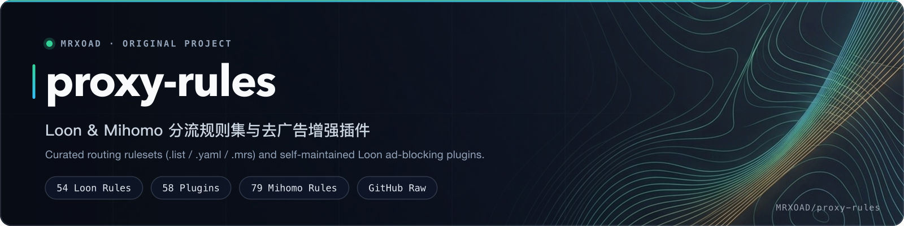

<p align="center">
  <picture>
    <source media="(prefers-color-scheme: dark)" srcset="assets/banner-dark.png" />
    <source media="(prefers-color-scheme: light)" srcset="assets/banner-light.png" />
    
  </picture>
</p>

<p align="center">
  
  
  
  
</p>

<p align="center">
  自用 <strong>Loon</strong> 与 <strong>Mihomo (Clash Meta)</strong> 分流规则集及自维护 Loon 去广告/增强插件仓库，可直接通过 GitHub Raw（或自选镜像）引入使用。
</p>

<p align="center">
  <a href="#目录结构">目录结构</a> ·
  <a href="#快速引入">快速引入</a> ·
  <a href="#规则与插件清单">完整清单</a> ·
  <a href="#致谢与上游来源">致谢上游</a>
</p>

---

## 目录结构

| 路径 | 数量 | 说明 |
| --- | --- | --- |
| `loon/rules/` | 54 份 | Loon 分流规则集（`.list`） |
| `loon/plugins/` | 55 个插件 + 44 个脚本 | 自维护 Loon 去广告与增强插件（含银行/App 专项去广告与 AdRewrite 聚合重写） |
| `loon/converted/` | 3 个插件 + 2 个脚本 | 第三方格式转换后的 Loon 插件（菜鸟裹裹、Twitch、墨鱼去开屏 2.0） |
| `mihomo/rules/` | 79 份 | Mihomo 规则集（`.list` / `.yaml` / `.mrs`） |

> 如需可莉系去广告与工具插件（如 HTTPDNS 拦截、常见 App 去广告），请直接前往原作者仓库订阅：[luestr/ProxyResource](https://github.com/luestr/ProxyResource)。

## 快速引入

### 1. Loon 远程规则集与插件

在 Loon 配置的 `[Remote Rule]` 中按需引入（策略名请替换为你自己的策略组名称）：

```ini
[Remote Rule]
https://raw.githubusercontent.com/MRXOAD/proxy-rules/main/loon/rules/AdRules.list, policy=REJECT, tag=AdRules, enabled=true
https://raw.githubusercontent.com/MRXOAD/proxy-rules/main/loon/rules/Direct.list, policy=DIRECT, tag=Direct, enabled=true
https://raw.githubusercontent.com/MRXOAD/proxy-rules/main/loon/rules/OpenAI.list, policy=OpenAI, tag=OpenAI, enabled=true
https://raw.githubusercontent.com/MRXOAD/proxy-rules/main/loon/rules/Claude.list, policy=Claude, tag=Claude, enabled=true
https://raw.githubusercontent.com/MRXOAD/proxy-rules/main/loon/rules/Google.list, policy=Google, tag=Google, enabled=true
https://raw.githubusercontent.com/MRXOAD/proxy-rules/main/loon/rules/China.list, policy=DIRECT, tag=China, enabled=true
```

在 Loon 配置的 `[Plugin]` 中按需引入去广告或功能插件：

```ini
[Plugin]
https://raw.githubusercontent.com/MRXOAD/proxy-rules/main/loon/plugins/AdRewrite.plugin, enabled=true
https://raw.githubusercontent.com/MRXOAD/proxy-rules/main/loon/plugins/UmetripAds.plugin, enabled=true
https://raw.githubusercontent.com/MRXOAD/proxy-rules/main/loon/plugins/ChinaMobileAds.plugin, enabled=true
```

### 2. Mihomo (Clash Meta) `rule-providers`

在 Mihomo 配置的 `rule-providers` 中按需引入（`.mrs` 为二进制高效格式，`.yaml` 为 YAML payload，`.list` 为 `format: text`）：

```yaml
rule-providers:
  AdRules:
    type: http
    behavior: domain
    format: mrs
    url: "https://raw.githubusercontent.com/MRXOAD/proxy-rules/main/mihomo/rules/AdRules.mrs"
    path: ./ruleset/AdRules.mrs
    interval: 86400

  Direct:
    type: http
    behavior: classical
    format: text
    url: "https://raw.githubusercontent.com/MRXOAD/proxy-rules/main/mihomo/rules/Direct.list"
    path: ./ruleset/Direct.list
    interval: 86400

  OpenAI:
    type: http
    behavior: classical
    format: yaml
    url: "https://raw.githubusercontent.com/MRXOAD/proxy-rules/main/mihomo/rules/OpenAI.yaml"
    path: ./ruleset/OpenAI.yaml
    interval: 86400

  ChinaDomain:
    type: http
    behavior: domain
    format: mrs
    url: "https://raw.githubusercontent.com/MRXOAD/proxy-rules/main/mihomo/rules/ChinaDomain.mrs"
    path: ./ruleset/ChinaDomain.mrs
    interval: 86400

  ChinaIP:
    type: http
    behavior: ipcidr
    format: mrs
    url: "https://raw.githubusercontent.com/MRXOAD/proxy-rules/main/mihomo/rules/ChinaIP.mrs"
    path: ./ruleset/ChinaIP.mrs
    interval: 86400
```

> 提示：国内直连访问 `raw.githubusercontent.com` 不稳定时，可自行将链接前缀替换为可用的镜像源或通过代理拉取。

## 规则与插件清单

<details>
<summary>Loon 分流规则集（54 份）</summary>

- [AdRules.list](loon/rules/AdRules.list)
- [Amazon.list](loon/rules/Amazon.list)
- [AppleIntelligence.list](loon/rules/AppleIntelligence.list)
- [AppleUS.list](loon/rules/AppleUS.list)
- [Bloomberg.list](loon/rules/Bloomberg.list)
- [BybitDirect.list](loon/rules/BybitDirect.list)
- [China.list](loon/rules/China.list)
- [Claude.list](loon/rules/Claude.list)
- [ClaudeDNS.list](loon/rules/ClaudeDNS.list)
- [Copilot.list](loon/rules/Copilot.list)
- [Crypto.list](loon/rules/Crypto.list)
- [Direct.list](loon/rules/Direct.list)
- [DirectApp.list](loon/rules/DirectApp.list)
- [Discord.list](loon/rules/Discord.list)
- [DisneyPlus.list](loon/rules/DisneyPlus.list)
- [DomesticDNS.list](loon/rules/DomesticDNS.list)
- [Epic.list](loon/rules/Epic.list)
- [Figma.list](loon/rules/Figma.list)
- [FutuBusiness.list](loon/rules/FutuBusiness.list)
- [FutuIdentity.list](loon/rules/FutuIdentity.list)
- [GeoIPCN.list](loon/rules/GeoIPCN.list)
- [GitHub.list](loon/rules/GitHub.list)
- [GitLab.list](loon/rules/GitLab.list)
- [Google.list](loon/rules/Google.list)
- [HBO.list](loon/rules/HBO.list)
- [HKshare.list](loon/rules/HKshare.list)
- [HuggingFace.list](loon/rules/HuggingFace.list)
- [Hulu.list](loon/rules/Hulu.list)
- [HuluJapan.list](loon/rules/HuluJapan.list)
- [LocalReject.list](loon/rules/LocalReject.list)
- [MEXC.list](loon/rules/MEXC.list)
- [Meta.list](loon/rules/Meta.list)
- [Microsoft.list](loon/rules/Microsoft.list)
- [Netflix.list](loon/rules/Netflix.list)
- [Notion.list](loon/rules/Notion.list)
- [OneDrive.list](loon/rules/OneDrive.list)
- [OpenAI.list](loon/rules/OpenAI.list)
- [Oracle.list](loon/rules/Oracle.list)
- [OracleVerification.list](loon/rules/OracleVerification.list)
- [Perplexity.list](loon/rules/Perplexity.list)
- [PlayStation.list](loon/rules/PlayStation.list)
- [PrimeVideo.list](loon/rules/PrimeVideo.list)
- [Reddit.list](loon/rules/Reddit.list)
- [RejectExtra.list](loon/rules/RejectExtra.list)
- [Reuters.list](loon/rules/Reuters.list)
- [Slack.list](loon/rules/Slack.list)
- [Spotify.list](loon/rules/Spotify.list)
- [SpotifyAccount.list](loon/rules/SpotifyAccount.list)
- [Steam.list](loon/rules/Steam.list)
- [Telegram.list](loon/rules/Telegram.list)
- [TikTok.list](loon/rules/TikTok.list)
- [US.list](loon/rules/US.list)
- [X.list](loon/rules/X.list)
- [Zoom.list](loon/rules/Zoom.list)

</details>

<details>
<summary>Mihomo 分流规则集（79 份）</summary>

- [AdRules.mrs](mihomo/rules/AdRules.mrs)
- [AdRules.yaml](mihomo/rules/AdRules.yaml)
- [Amazon.list](mihomo/rules/Amazon.list)
- [Apns.list](mihomo/rules/Apns.list)
- [Apple.yaml](mihomo/rules/Apple.yaml)
- [AppleDirect.yaml](mihomo/rules/AppleDirect.yaml)
- [AppleIntelligence.yaml](mihomo/rules/AppleIntelligence.yaml)
- [AppleMediaDirect.yaml](mihomo/rules/AppleMediaDirect.yaml)
- [AppleMediaRegion.yaml](mihomo/rules/AppleMediaRegion.yaml)
- [AppleUS.yaml](mihomo/rules/AppleUS.yaml)
- [Bloomberg.list](mihomo/rules/Bloomberg.list)
- [BybitDirect.list](mihomo/rules/BybitDirect.list)
- [China.yaml](mihomo/rules/China.yaml)
- [ChinaDomain.mrs](mihomo/rules/ChinaDomain.mrs)
- [ChinaIP.mrs](mihomo/rules/ChinaIP.mrs)
- [ChinaKeyword.yaml](mihomo/rules/ChinaKeyword.yaml)
- [ChinaProcess.yaml](mihomo/rules/ChinaProcess.yaml)
- [Claude.yaml](mihomo/rules/Claude.yaml)
- [CloudflareChallenge.yaml](mihomo/rules/CloudflareChallenge.yaml)
- [CollectReject.list](mihomo/rules/CollectReject.list)
- [Copilot.yaml](mihomo/rules/Copilot.yaml)
- [Crypto.yaml](mihomo/rules/Crypto.yaml)
- [Direct.list](mihomo/rules/Direct.list)
- [Discord.list](mihomo/rules/Discord.list)
- [DisneyPlus.list](mihomo/rules/DisneyPlus.list)
- [Epic.list](mihomo/rules/Epic.list)
- [ExchangeDirect.yaml](mihomo/rules/ExchangeDirect.yaml)
- [Figma.list](mihomo/rules/Figma.list)
- [FutuBusiness.list](mihomo/rules/FutuBusiness.list)
- [FutuIdentity.list](mihomo/rules/FutuIdentity.list)
- [Gemini.yaml](mihomo/rules/Gemini.yaml)
- [GitHub.yaml](mihomo/rules/GitHub.yaml)
- [GitLab.list](mihomo/rules/GitLab.list)
- [Google.yaml](mihomo/rules/Google.yaml)
- [GoogleFCM.yaml](mihomo/rules/GoogleFCM.yaml)
- [GoogleVoice.yaml](mihomo/rules/GoogleVoice.yaml)
- [HBO.list](mihomo/rules/HBO.list)
- [HKBanks.list](mihomo/rules/HKBanks.list)
- [HKshare.list](mihomo/rules/HKshare.list)
- [HTTPDNS.list](mihomo/rules/HTTPDNS.list)
- [HTTPDNSAllowed.list](mihomo/rules/HTTPDNSAllowed.list)
- [HuggingFace.list](mihomo/rules/HuggingFace.list)
- [Hulu.list](mihomo/rules/Hulu.list)
- [HuluJapan.list](mihomo/rules/HuluJapan.list)
- [Lan.yaml](mihomo/rules/Lan.yaml)
- [LocalReject.list](mihomo/rules/LocalReject.list)
- [MEXC.list](mihomo/rules/MEXC.list)
- [Meta.yaml](mihomo/rules/Meta.yaml)
- [Microsoft.yaml](mihomo/rules/Microsoft.yaml)
- [Netflix.list](mihomo/rules/Netflix.list)
- [NotebookLM.list](mihomo/rules/NotebookLM.list)
- [Notion.list](mihomo/rules/Notion.list)
- [OKXDirect.yaml](mihomo/rules/OKXDirect.yaml)
- [OneDrive.yaml](mihomo/rules/OneDrive.yaml)
- [OpenAI.yaml](mihomo/rules/OpenAI.yaml)
- [OpenAIVoiceIP.list](mihomo/rules/OpenAIVoiceIP.list)
- [Oracle.yaml](mihomo/rules/Oracle.yaml)
- [OracleVerification.yaml](mihomo/rules/OracleVerification.yaml)
- [PayPal.yaml](mihomo/rules/PayPal.yaml)
- [Perplexity.list](mihomo/rules/Perplexity.list)
- [PlayStation.list](mihomo/rules/PlayStation.list)
- [PrimeVideo.list](mihomo/rules/PrimeVideo.list)
- [Reddit.list](mihomo/rules/Reddit.list)
- [Reuters.list](mihomo/rules/Reuters.list)
- [Scholar.yaml](mihomo/rules/Scholar.yaml)
- [Slack.list](mihomo/rules/Slack.list)
- [SmartHomeRealIP.yaml](mihomo/rules/SmartHomeRealIP.yaml)
- [Spotify.list](mihomo/rules/Spotify.list)
- [SpotifyAccount.list](mihomo/rules/SpotifyAccount.list)
- [Steam.yaml](mihomo/rules/Steam.yaml)
- [Talkatone.yaml](mihomo/rules/Talkatone.yaml)
- [Telegram.yaml](mihomo/rules/Telegram.yaml)
- [TikTok.list](mihomo/rules/TikTok.list)
- [Twitter.yaml](mihomo/rules/Twitter.yaml)
- [WeChat.yaml](mihomo/rules/WeChat.yaml)
- [YouTube.yaml](mihomo/rules/YouTube.yaml)
- [Zoom.list](mihomo/rules/Zoom.list)
- [ZoomMeetingsIP.list](mihomo/rules/ZoomMeetingsIP.list)
- [iCloud.yaml](mihomo/rules/iCloud.yaml)

</details>

<details>
<summary>Loon 自维护与聚合去广告插件（55 个）</summary>

- [ABCAds.plugin](loon/plugins/ABCAds.plugin)
- [AdRewrite.plugin](loon/plugins/AdRewrite.plugin)
- [BOCAds.plugin](loon/plugins/BOCAds.plugin)
- [BocomAds.plugin](loon/plugins/BocomAds.plugin)
- [BooheeAds.plugin](loon/plugins/BooheeAds.plugin)
- [CCBAds.plugin](loon/plugins/CCBAds.plugin)
- [CCBLifeAds.plugin](loon/plugins/CCBLifeAds.plugin)
- [CGBAds.plugin](loon/plugins/CGBAds.plugin)
- [CIBAds.plugin](loon/plugins/CIBAds.plugin)
- [CIBLifeAds.plugin](loon/plugins/CIBLifeAds.plugin)
- [CITICBankAds.plugin](loon/plugins/CITICBankAds.plugin)
- [CITICCreditAds.plugin](loon/plugins/CITICCreditAds.plugin)
- [CMBAds.plugin](loon/plugins/CMBAds.plugin)
- [CMBCAds.plugin](loon/plugins/CMBCAds.plugin)
- [CMBCCAds.plugin](loon/plugins/CMBCCAds.plugin)
- [CSDNADS.plugin](loon/plugins/CSDNADS.plugin)
- [CaixinAds.plugin](loon/plugins/CaixinAds.plugin)
- [ChinaMobileAds.plugin](loon/plugins/ChinaMobileAds.plugin)
- [CtripAds.plugin](loon/plugins/CtripAds.plugin)
- [DangdangAds.plugin](loon/plugins/DangdangAds.plugin)
- [DianpingAds.plugin](loon/plugins/DianpingAds.plugin)
- [EastmoneyAds.plugin](loon/plugins/EastmoneyAds.plugin)
- [ElemeAds.plugin](loon/plugins/ElemeAds.plugin)
- [FanqieAds.plugin](loon/plugins/FanqieAds.plugin)
- [GRCBAds.plugin](loon/plugins/GRCBAds.plugin)
- [HuazhuAds.plugin](loon/plugins/HuazhuAds.plugin)
- [HupuAds.plugin](loon/plugins/HupuAds.plugin)
- [ICBCAds.plugin](loon/plugins/ICBCAds.plugin)
- [JDAds.plugin](loon/plugins/JDAds.plugin)
- [KeepAds.plugin](loon/plugins/KeepAds.plugin)
- [MafengwoAds.plugin](loon/plugins/MafengwoAds.plugin)
- [MaidanbaAds.plugin](loon/plugins/MaidanbaAds.plugin)
- [McDonaldsAds.plugin](loon/plugins/McDonaldsAds.plugin)
- [MeituanAds.plugin](loon/plugins/MeituanAds.plugin)
- [MiguVideoAds.plugin](loon/plugins/MiguVideoAds.plugin)
- [PABAds.plugin](loon/plugins/PABAds.plugin)
- [PSBCAds.plugin](loon/plugins/PSBCAds.plugin)
- [PinduoduoAds.plugin](loon/plugins/PinduoduoAds.plugin)
- [PingAnCarAds.plugin](loon/plugins/PingAnCarAds.plugin)
- [PingAnStockAds.plugin](loon/plugins/PingAnStockAds.plugin)
- [PupuAds.plugin](loon/plugins/PupuAds.plugin)
- [QunarAds.plugin](loon/plugins/QunarAds.plugin)
- [SFExpressAds.plugin](loon/plugins/SFExpressAds.plugin)
- [SPDBAds.plugin](loon/plugins/SPDBAds.plugin)
- [SamsClubAds.plugin](loon/plugins/SamsClubAds.plugin)
- [TencentVideoAds.plugin](loon/plugins/TencentVideoAds.plugin)
- [TongchengAds.plugin](loon/plugins/TongchengAds.plugin)
- [TonghuashunAds.plugin](loon/plugins/TonghuashunAds.plugin)
- [TuniuAds.plugin](loon/plugins/TuniuAds.plugin)
- [UmetripAds.plugin](loon/plugins/UmetripAds.plugin)
- [UnionPayAds.plugin](loon/plugins/UnionPayAds.plugin)
- [VipshopAds.plugin](loon/plugins/VipshopAds.plugin)
- [XiaomiAds.plugin](loon/plugins/XiaomiAds.plugin)
- [iQiyiAds.plugin](loon/plugins/iQiyiAds.plugin)
- [iReaderAds.plugin](loon/plugins/iReaderAds.plugin)

</details>

<details>
<summary>Loon 已转换第三方插件（3 个）</summary>

- [CainiaoAds.plugin](loon/converted/CainiaoAds.plugin)
- [MoyuSplashAds.plugin](loon/converted/MoyuSplashAds.plugin)
- [TwitchAds.plugin](loon/converted/TwitchAds.plugin)

</details>

## 致谢与上游来源

本仓库的规则集与去广告插件在大量优秀开源项目和社区作者的长期维护基础上整合、去重与适配，特此向以下项目与作者致谢（排名不分先后）：

### 分流与去广告规则上游
- [blackmatrix7/ios_rule_script](https://github.com/blackmatrix7/ios_rule_script) — 绝大多数业务分流规则的核心上游
- [MetaCubeX/meta-rules-dat](https://github.com/MetaCubeX/meta-rules-dat) — Mihomo Geosite / GeoIP 及多平台规则数据
- [Loyalsoldier/clash-rules](https://github.com/Loyalsoldier/clash-rules) — Clash / Mihomo 经典规则集
- [SukkaW/Surge](https://github.com/SukkaW/Surge) — Apple Intelligence 等精细规则参考
- [Benjam1nF/ProxyRes](https://github.com/Benjam1nF/ProxyRes) — Talkatone 等专项规则
- [privacy-protection-tools/anti-AD](https://github.com/privacy-protection-tools/anti-AD) — 中文区广告拦截规则
- [Cats-Team/AdRules](https://github.com/Cats-Team/AdRules) — AdRules 广告过滤规则
- [hagezi/dns-blocklists](https://github.com/hagezi/dns-blocklists) — HaGeZi Pro++ DNS 拦截列表
- [AdGuardTeam/AdGuardSDNSFilter](https://github.com/AdguardTeam/AdGuardSDNSFilter) — AdGuard DNS Filter
- [TG-Twilight/AWAvenue-Ads-Rule](https://github.com/TG-Twilight/AWAvenue-Ads-Rule) — 秋风广告规则
- [oisd](https://oisd.nl/) — OISD Big Blocklist
- [fmz200/wool_scripts](https://github.com/fmz200/wool_scripts) — 广告拦截与重写规则上游

### Loon 插件与脚本作者
- [可莉🅥 (luestr/ProxyResource)](https://github.com/luestr/ProxyResource) & [luestr/IconResource](https://github.com/luestr/IconResource) — 可莉去广告插件体系、HTTPDNS 拦截与图标资源
- [RuCu6](https://github.com/RuCu6) — 大量国内 App 去广告重写与脚本
- [ddgksf2013](https://github.com/ddgksf2013) — 墨鱼去开屏 2.0、菜鸟裹裹去广告等重写规则
- [xingjiu29/Umetrip](https://github.com/xingjiu29/Umetrip) — 航旅纵横去广告脚本
- [VirgilClyne](https://github.com/VirgilClyne)、[Maasea](https://github.com/Maasea)、[Keywos](https://github.com/Keywos)、[xream](https://github.com/xream)、[Script-Hub](https://github.com/Script-Hub-Org/Script-Hub) — 网络检测、脚本转换与重写工具生态
- [Choler](https://github.com/Choler)、[DivineEngine](https://github.com/DivineEngine)、[app2smile](https://github.com/app2smile)、[zirawell](https://github.com/zirawell)、[kokoryh](https://github.com/kokoryh)、[zZPiglet](https://github.com/zZPiglet)、[zmqcherish](https://github.com/zmqcherish)、[I-am-R-E](https://github.com/I-am-R-E)、[KOP-XIAO](https://github.com/KOP-XIAO)、[dcpengx](https://github.com/dcpengx)、[CKYB](https://github.com/CKYB)、[001ProMax](https://github.com/001ProMax)、Yswag、wish、小白脸、怎么个事 — 各类专项去广告与增强插件作者

如上述致谢名单有遗漏或链接变更，欢迎提交 Issue 补充修正。

## 免责声明

- 本仓库仅供个人学习与网络调试交流使用，不提供任何代理节点或服务。
- 上游规则与脚本的版权归原作者所有，各插件文件内均保留原作者 `#!author` 署名。
